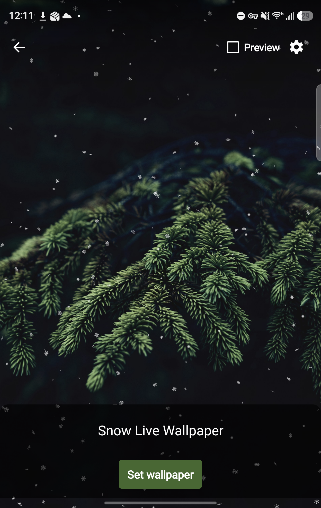
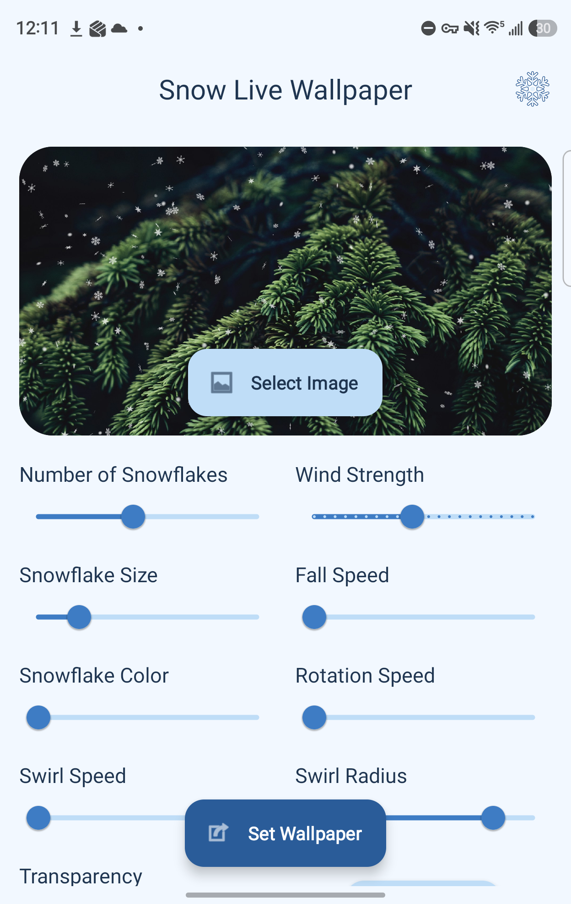
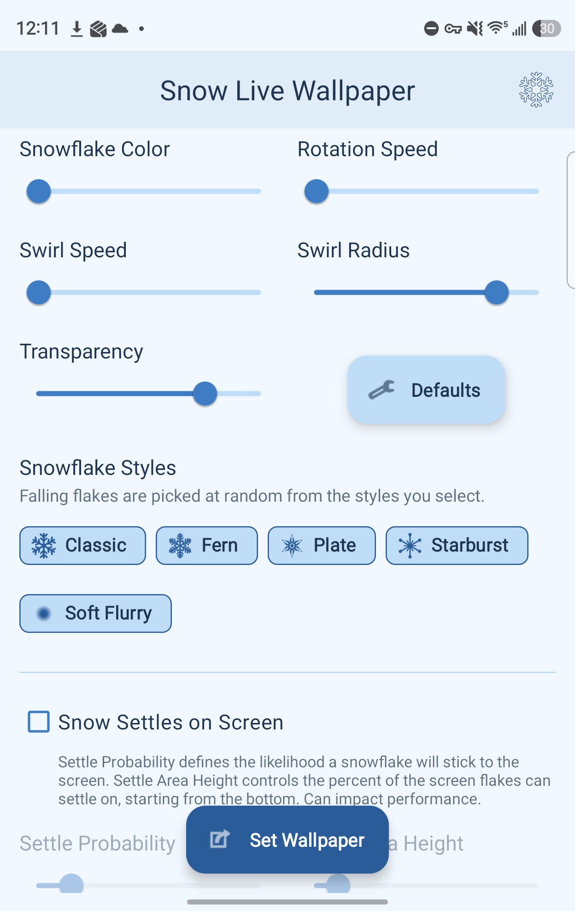

  

<h1 align="center">Snow Live Wallpaper</h1>

  
  
  

A beautiful, highly customizable Android Live Wallpaper that brings the quiet calm of falling snow to your home screen. Designed with modern Android standards and a focus on performance and "Expressive" Material 3 aesthetics.

## ✨ Features

- **Realistic Animation**: Smoothly animated snowflakes with individual rotation, swaying, and vertical oscillation for a natural look.
- **Dynamic Physics**:
    - **Wind Strength**: Control the horizontal drift and breeze intensity.
    - **Fall Speed**: Adjust how quickly the snow descends, from a slow drift to a steady fall.
    - **Rotation Speed**: Fine-tune the tumbling motion of each flake.
    - **Turbulence & Swirls**: Add complex air currents with adjustable turbulence speed and radius for more organic, swirling paths.
- **Visual Customization**:
    - **Snowflake Count**: Scale from a light flurry to a full blizzard (up to 500 active flakes).
    - **Snowflake Size & Transparency**: Customize the scale and alpha of the flakes.
    - **Custom Colors**: Interpolate between pure white and a cool icy blue.
    - **Snowflake Styles**: Choose any mix of five designs (Classic, Fern, Plate, Starburst and Soft Flurry). Each falling flake picks one at random from your selection.
- **Interactive Elements**:
    - **Snow Settles on Screen**: Let snowflakes settle along the bottom of your screen and build up into a snowbank.
    - **Pile Customization**: Adjust the maximum pile height and the probability of flakes settling.
    - **Shake to Clear**: Uses the device accelerometer. Shake your phone to blow the settled snow away in a gust of wind.
- **Optimization**:
    - **Battery Saver Aware**: Automatically scales target frame rate (30 FPS in Power Save Mode, 60 FPS otherwise) to preserve battery life.
    - **Hardware Acceleration**: Utilizes hardware-accelerated canvases for smooth rendering on modern devices.
- **Personalized Backgrounds**: Select any image from your device to serve as the backdrop for the falling snow.
- **Modern UI**: A sleek settings menu using **Material 3 Expressive** design norms, featuring:
    - Interactive live preview window.
    - Two-column slider layout for efficiency.
    - Responsive design for both phones and tablets/landscape orientations.

## 📸 Screenshots

| Live Wallpaper | Settings & Live Preview | Snowflake Styles |
| :---: | :---: | :---: |
|  |  |  |

Background photo in screenshots by Matthias Heil.

## ❄️ Snowflake Styles

Pick any combination in the settings; every falling flake chooses one at random from your selection.

| Style | Description |
| :--- | :--- |
| **Classic** | Six arms with two V-shaped branches each, matching the app icon. |
| **Fern** | A feathery dendrite with four pairs of fine branches per arm. |
| **Plate** | A solid six-pointed stellar plate with etched facet lines. |
| **Starburst** | Six long rays with dotted tips and six short rays between them. |
| **Soft Flurry** | A soft, glowing dot, like out-of-focus snow in the distance, for depth. |

## 🛠️ How It Was Made

This project began as a fork of [Sakura Live Wallpaper](https://github.com/wylew/Sakura_Live_Wallpaper) and shares its rendering engine. It was built using modern Android development practices:

- **Kotlin**: The entire logic is written in Kotlin for safety and conciseness.
- **Custom Canvas Rendering**: The wallpaper engine uses a low-level `Canvas` and `SurfaceHolder` approach to render hundreds of snowflakes at 60 FPS without the overhead of heavy graphics libraries.
- **Vector-based Math**: Each snowflake follows a unique path calculated using sine wave oscillations, circular motion vectors (for turbulence), and global gusts for drift and gravity.
- **Material 3 (M3)**: The settings interface utilizes the latest Google Material 3 components, including `Slider`, `MaterialCheckBox`, and `MaterialCardView`, ensuring a native look and feel on modern Android devices.
- **Sensor API**: Integrated `SensorManager` to detect G-force thresholds, enabling the immersive "Shake to Clear" interaction.
- **Responsive Layouts**: Uses resource qualifiers (`layout-sw600dp`) to provide an optimized side-by-side experience for tablets and large-screen devices.

## 🚀 Installation

1. Clone this repository.
2. Open in **Android Studio Hedgehog** or newer.
3. Build and run the `:app` module on your device or emulator.
4. Open the app to configure your settings, then tap **Set Wallpaper** to apply.

---
*Created with ❤️ for the Android community.*
